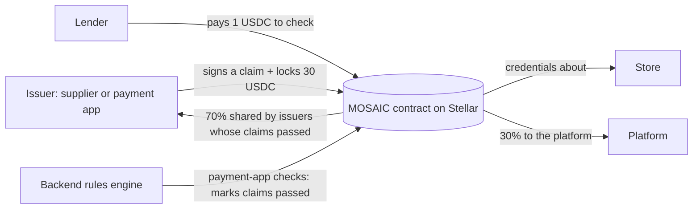

# MOSAIC

**MOSAIC lets distributors and payment apps vouch for the neighbourhood stores they already work with, so lenders can check that proof on Stellar and give those stores a loan.**

| | |
|---|---|
| **Live app** | https://mosiac-eight.vercel.app |
| **Demo video** | _coming soon_ |
| **Contract (Stellar testnet)** | `CBEGE446VFXBKELMBXSLQZGVX3QMCQJMKUU5MXIKK6CO2KF7C575CYDG` ([Stellar Expert](https://stellar.expert/explorer/testnet/contract/CBEGE446VFXBKELMBXSLQZGVX3QMCQJMKUU5MXIKK6CO2KF7C575CYDG)) |
| **Devpost** | _coming soon_ |

Built for the *Blockchain Innovation Challenge powered by Stellar*, Problem Space 2: Verification Infrastructure for the Next Billion Customers. **Testnet only.**

## The problem

A small shop in India (a kirana) can run for ten years and still have no credit history. A lender has nothing to look at, so the shop gets no loan or a very expensive one. But the shop *does* have a record: its supplier knows it has bought stock every month for years, and its payment app sees the money coming in. That proof exists. It just isn't in a form a lender can trust.

## How it works

1. **Issuer (a supplier or a payment app).** It applies and the admin approves it. An approved issuer signs a one-line claim about a shop ("regular buyer for 18 months, pays on time" or "UPI receipts above ₹50,000 a month") and locks a **30 USDC stake** behind it.
2. **Store owner.** The shop pays nothing and never touches crypto. A shop is just a name; it needs no wallet.
3. **Lender.** A lender pays **1 USDC** to check a shop. It sees every credential with six fraud checks and a loan recommendation, then approves or declines.



## What's different

- **Staking.** An issuer locks 30 USDC (test USDC) per credential. It is returned after the credential expires (90 days), unless the claim is proven false.
- **Disputes.** A lender who checked the shop can dispute a credential. The admin decides. If upheld, the stake is paid to the lender, the credential is revoked and the issuer gets a strike. **Two upheld disputes suspend the issuer.** A dispute can only be upheld after a lender reports that the shop defaulted, so a claim is not "proven false" just because someone says so.
- **Stacking counter.** Every check increments a per-shop counter. The lender sees how many lender checks a shop had in the last 30 days, so it can spot a shop borrowing from many lenders at once. The loan limit is halved when there are 3 or more.
- **Privacy.** Payment records, bank accounts and phone numbers stay off-chain. On-chain there is only the one-line conclusion, a hash of the evidence, the issuer, the dates and the stake. See [On-chain vs off-chain](#on-chain-vs-off-chain).
- **Unknown, never bad.** Missing evidence shows as *Unknown*. It is never held against a shop.

### The six checks

| # | Check | Rule | Runs on |
|---|---|---|---|
| 1 | Issuer gate | Only issuers the admin approved can sign | Contract |
| 2 | Payment match | A supplier's "₹X a month" counts only if **payment-app records** show the shop paid that supplier's verified account at least 70% of X over 6 months. What the supplier types is shown as "Supplier says" and never used. | Backend |
| 3 | Independence | An issuer that shares an owner, phone, bank account or address with the shop is not counted. The matching field is shown. | Backend |
| 4 | Net flow | Money the supplier's account sent back within 30 days is subtracted (from payment-app data), then check 2 is run again | Backend |
| 5 | Stake and claim | 30 USDC locked per claim. If upheld after a default, the stake goes to the lender. 2 upheld claims suspend the issuer. | Contract |
| 6 | Stacking counter | Lender checks on this shop in the last 30 days | Contract |

## How it makes money

- The **lender pays 1 USDC** for each check.
- **70% is shared equally** by the issuers whose claims passed the checks and are still valid. The other **30% goes to the platform.** If no issuer earned anything, the lender pays only the platform's 30%.
- **Store owners pay nothing.**

## Tech stack

- **Smart contract:** Rust + Soroban (soroban-sdk 28), Stellar testnet, a test USDC token (a classic asset wrapped as a Soroban token).
- **App:** Next.js (App Router, TypeScript, Tailwind) with its own server backend.
- **Data:** Upstash Redis (cloud database), Resend (email codes), deployed on Vercel.
- **Rules engine:** plain TypeScript functions, no ML. Missing evidence is always *Unknown*.

## On-chain vs off-chain

| On-chain (public) | Off-chain (private) |
|---|---|
| Issuer registry, and issuer requests (only a hash of the evidence) | Payment records and bank accounts |
| Per credential: shop name, claim type, **one-line conclusion**, **hash** of the evidence, issuer, issue and expiry dates, stake, whether it passed | GST and RBI registration details, phone numbers, emails |
| Disputes, strikes, suspensions | Loan requests and lender decisions |
| The stacking counter, the USDC fee and stake transfers | The rules engine's workings |

The one-line conclusion is public and can contain the claimed monthly amount (for example "buys ₹45,000 a month"). The records behind it are not.

## Contract functions

`contracts/mosaic/src/lib.rs`. Who can call each:

| Function | Who | What it does |
|---|---|---|
| `init` | admin (signs) | One-time setup: USDC token, fee, issuer share, stake |
| `add_issuer` | admin | Approve an issuer (check 1) |
| `request_issuer` | the applicant | Ask to join; only a hash of the evidence is stored |
| `reject_issuer` | admin | Reject a request (the applicant may apply again) |
| `issue_credential` | an approved issuer | Sign a claim about a shop and lock the 30 USDC stake |
| `mark_checked` | admin (for the backend) | Record whether a claim passed the backend's checks |
| `revoke` | the issuer of that credential | Withdraw a claim (the stake stays locked until it expires) |
| `release_stake` | the issuer | Get the stake back after expiry, if no dispute is open |
| `verify` | a lender | Pay the fee, split it, return the 30-day stacking count |
| `report_default` | a lender who checked the shop | Report that the shop defaulted |
| `open_dispute` | a lender who checked the shop | Say a credential is false |
| `resolve_dispute` | admin | Uphold (stake to the lender, strike) or reject |
| `get_credentials`, `get_issuer`, `get_config`, `get_dispute`, `get_issuer_request` | anyone | Read one record |
| `list_issuers`, `list_shops`, `list_disputes`, `list_issuer_requests`, `checks_last_30_days`, `has_defaulted` | anyone | Read lists and counters |
| `keep_alive` | anyone | Extend the life of a shop's stored credentials |

## Setup

Prerequisites: Rust, the Stellar CLI (`stellar`, tested with 28.1.0), Node (tested with 24) and Google Chrome (for the browser tests).

```sh
# Contract: test and build
cargo test                       # 34 tests
stellar contract build           # builds target/wasm32v1-none/release/mosaic.wasm

# Contract: deploy a fresh copy to testnet (needs the CLI keys `admin` and `usdc_issuer`)
./scripts/deploy.sh mosaic_v3      # deploys to a new alias, writes deployments/mosaic_v3.json
./scripts/seed.sh                # puts the demo (4 issuers, 5 credentials) on the contract; safe to run twice

# Web app
cd web
npm install
npm run dev                      # http://localhost:3000, works with no keys (data is kept in a local file)
npm run build                    # production build
npm test                         # all web tests (engine, cloud stand-ins, browser)
```

Environment variables are listed in [`web/.env.example`](web/.env.example). Never commit real values. Deploying the app (Vercel + Upstash + Resend): [`web/README.md`](web/README.md#deploy-to-vercel-step-by-step).

## How to test on the live app

1. Open https://mosiac-eight.vercel.app. The example data loads itself on the first visit.
2. Press **Try the demo with Sharma Store**. It opens the lender view (Saathi Microfinance) on Sharma Store, Delhi.
3. Press **Check the shop**. The lender pays 1 USDC, and the verdict card shows "Approve up to ₹22,500", "6 of 6 checks passed", and where the fee went. With testnet keys on the server it shows a real Stellar Expert link; otherwise it says "simulated".
4. Press **Review** on **Sunrise Mart**, then **Check the shop**: "Unknown, not bad", no limit, "needs an independent payment app".
5. Back on Sharma Store, open **QuickSupply** and **Anand Traders** in the evidence list: QuickSupply fails net flow (₹1,40,000 of ₹1,50,000 came straight back), Anand Traders fails independence (same phone and bank account as the shop). Both show as "Not counted".
6. Press **Demo: 2 other lenders also check this shop** to see the stacking warning.
7. To see a slash: on QuickSupply press **Open dispute**, then **Report a default**, switch "You are" to Mosaic admin and press **Uphold and slash**. The 30 USDC stake goes to the lender.

A click-by-click script with what to say is in [`DEMO.md`](DEMO.md).

## Tests

- **Contract:** `cargo test`: 34 pass.
- **Web (TypeScript):** `cd web && npm test`: 202 engine tests (rules 57, onboarding 46, shop review 28, loans 29, demo cases 23, testnet mirror 14, rate limit 5), 31 cloud tests and 128 browser tests, all pass.

## Verified on testnet

Every link is a real transaction on the Stellar testnet contract above.

| What | Transaction |
|---|---|
| Approve PayLink, 3 and 4 (check 1) | [PayLink](https://stellar.expert/explorer/testnet/tx/6b25b1402fe62a19af5434d84db49af6abf979a4c9a5a3443a04b6b932383193), [QuickSupply](https://stellar.expert/explorer/testnet/tx/9d9f71dd278e99cde5c1b875a0fadca590a87000ac85f0a782ed410239b99c9a), [Anand Traders](https://stellar.expert/explorer/testnet/tx/e81b19841fbfc72da5e877f9afc1f1bdbb280814c3040217ac9c249824ee4dc7) |
| Issue credentials, each locking 30 USDC | [payment app on Sharma Store](https://stellar.expert/explorer/testnet/tx/84db28679b74d21e95c7b06db93d416c660a447fb00bcda6c9c39334023e2c80), [QuickSupply on Sharma Store](https://stellar.expert/explorer/testnet/tx/ada6920ec9bc8070d9c101ecb202b4c9d6aea774a4755fe1739de7a7dd11dad1), [self-dealer on Sharma Store](https://stellar.expert/explorer/testnet/tx/7e94fb33dc62496aacd5d5ab7f4b367293749a140d6852cd44c6ab00de96690b), [QuickSupply on Sunrise Mart](https://stellar.expert/explorer/testnet/tx/a2e57dc206a0a134aa25976f4bbd6dced9386dae8d0709fc000da8fba75d1ac3) |
| Backend marks a claim as passed | [mark_checked](https://stellar.expert/explorer/testnet/tx/faa56d4047d72e689ea8cfe90b6e906c2ea4bb21a7efb6d7580b997f835df1d3) |
| **Lender fee split:** the lender paid 1 USDC, 0.70 went to the supplier and 0.30 to the platform | [verify](https://stellar.expert/explorer/testnet/tx/17474d8c6f43f14a9b32611f470ae0c74f48047036fcc181a3d132753a57013f) |
| **Dispute and slash:** default reported, dispute opened, upheld, the 30 USDC stake paid to the lender, the issuer gets a strike | [report_default](https://stellar.expert/explorer/testnet/tx/aabaefb04b070db61195c19ab31909adcf5579810ef23bf5dd4321f530ee7ca7), [open_dispute](https://stellar.expert/explorer/testnet/tx/c298e2b0840cacbdd6c70b480d7cd25ca647d4eaa8e331beffc44b6379ffa257), [resolve_dispute](https://stellar.expert/explorer/testnet/tx/14b81f35c177eb1e2c6f2d1cc751e24cdc04a8de97d42940ac3cc1fd2aaba3c6) |
| **Sent from the website** (run locally against the real contract): issue, verify, revoke | [issue](https://stellar.expert/explorer/testnet/tx/73a3e7a017e81c20c977a053c08f7a836a16fd79188b703cc5f24d0897100441), [verify](https://stellar.expert/explorer/testnet/tx/09ce14a85f134c210f96d0c12653afc4d9ce4122a0fa421258bb875776a80237), [revoke](https://stellar.expert/explorer/testnet/tx/22af9c3532b5cda9a7f4081eba1739e9ffeb215e24ba54e6f1dd04f3e102a2e0) |

`scripts/seed.sh` produced the issuer and credential rows, and it is safe to run twice (the second run sent nothing). `scripts/deploy.sh` was run into a separate test contract, `CD6E5LEF2WDNMXJEPZU3DAFFJYOQ4KZZ23GUH6TB2AZFS6F47X6GHKLR`, recorded in `deployments/mosaic_v3.json`. The main contract above was not changed.

## Testnet accounts and what they play

| Role in the demo | Stellar CLI key | Environment variable (server) |
|---|---|---|
| Platform admin | `admin` | `STELLAR_SECRET_ADMIN` |
| Gupta Wholesale, honest supplier | `supplier` | `STELLAR_SECRET_SUPPLIER` |
| PayLink, payment app | `payment_provider` | `STELLAR_SECRET_PAYMENT_APP` |
| QuickSupply, QuickSupply (inflated claim, round trip) | `fake_issuer` | `STELLAR_SECRET_QUICKSUPPLY` |
| Anand Traders, self-dealing supplier | `self_dealer` | `STELLAR_SECRET_SELFDEALER` |
| Saathi Microfinance | `lender` | `STELLAR_SECRET_LENDER` |
| Test USDC issuer | `usdc_issuer` | not needed by the website |

The keys live in the Stellar CLI keystore and, for the website, only in server environment variables (Vercel "Secret" values or a local `.env`). They are never in the repo.

## How the website talks to the contract

The website keeps its own fast simulation of the contract. When the server has the testnet keys above, each of these actions is **also sent to the real contract**, and the result shows a real transaction link to Stellar Expert: `add_issuer`, `issue_credential`, `mark_checked`, `verify`, `revoke`, `report_default`, `open_dispute`, `resolve_dispute`. For `verify`, the fee split shown is read from the transaction's own events. If the chain refuses or can't be reached, the person sees "Not sent to Stellar" and the simulated change is undone: no fake success. Anything not sent (loading the demo, the 30- and 90-day time-skip buttons, requesting to join, releasing a stake) is labelled **simulated**. Without keys on the server, everything is labelled simulated. The On-chain panel (Lender and Admin pages) shows which mode the server is in.

## Honest limits

- **Not everything is sent to Stellar.** The actions listed above are. The example data, time-skips, issuer requests and stake release are simulated and say so. The pages read the simulation, not the chain, so the simulation and the chain can differ (for example the on-chain stacking counter also counts checks made from the command line).
- **Live mirroring needs the server keys.** The mirror was tested locally against the real contract (see the table above). It is only active on the live site once the keys are set in Vercel.
- **The shop cannot yet choose which credentials a lender sees.** A lender who pays sees all of a shop's credentials. Consent and share links are planned.
- Without wallets, "You are" lets any visitor play any role. That's fine for a demo; wallet signatures will fix it.
- GST and RBI registry lookups, sales records and payment records are fake demo data.
- The USDC is a test token on testnet.
- Not a KYC replacement: MOSAIC shows trading relationships, not identity.

## Roadmap

- Send every website action to the contract (today: the main ones), and read from the chain instead of the simulation.
- Shop consent: the shop chooses which credentials a lender can see.
- Real issuer onboarding with live registry lookups and a real payment-app data feed.
- Shopify and other online sellers as issuers.
- A lender API and a lender dashboard.

## Team

- **Jeeshaan Bakshi**: product and smart contract
- **Ashmit Bharti**: _role to be filled in_
